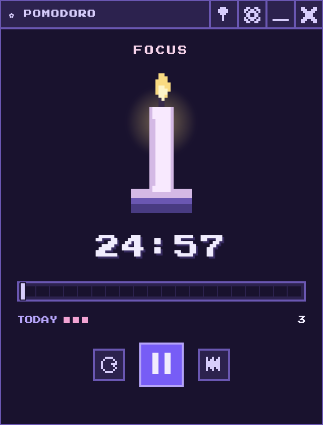
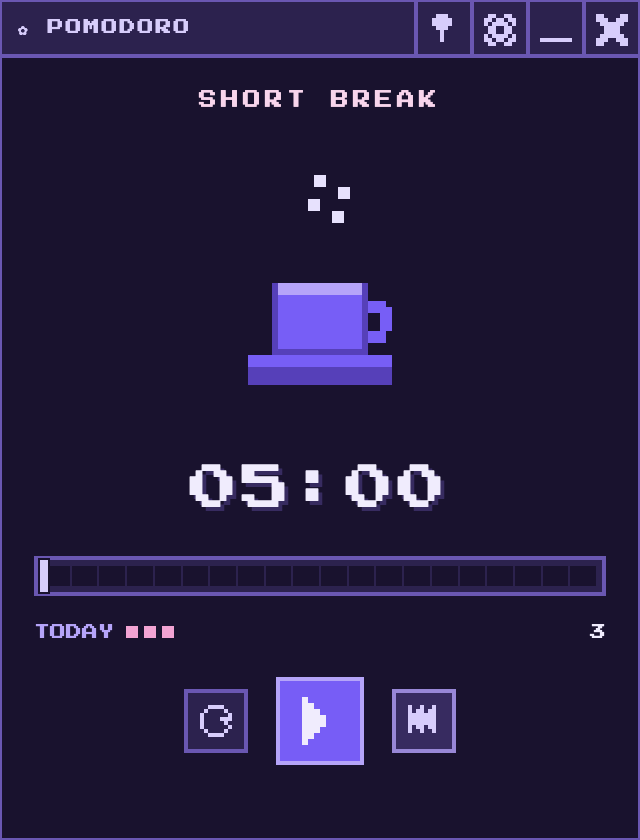

# Pixel Pomodoro

[](https://github.com/malenitaa/pomodoro/releases/latest)
[](./LICENSE)
[](#)
[](./SECURITY.md)

**Pixel Pomodoro** is a free Pomodoro timer for Mac and Windows with a
pixel-art look (a melting candle and a steaming teacup). It runs on your
computer, doesn't need the internet, doesn't ask for accounts or personal
data, and sends absolutely nothing to any server — everything it stores
stays on your own machine. The interface is available in **English and
Spanish** (it follows your system language, and you can override it in
Settings).

<p align="center">
  
  
</p>

## What do I need to install it?

- A **macOS** (13 Ventura or later) or **Windows** (10 or later) computer.

That's it. No account needed, no Node install, nothing technical.

## Installation, step by step

**On a Mac:**

1. Go to [Releases](https://github.com/malenitaa/pomodoro/releases) and download the `.dmg` for your Mac (`arm64` if it's a Mac with an Apple M1/M2/M3/M4 chip, or the other `.dmg` if it's an older Intel Mac — if you're not sure, try `arm64` first).
2. Open the downloaded `.dmg` and drag **"Pixel Pomodoro"** to your Applications folder.

**On Windows:**

1. Go to [Releases](https://github.com/malenitaa/pomodoro/releases) and download `Pixel Pomodoro Setup x.x.x.exe`.
2. Run it and follow the installer (you can choose the install folder).

## The first time you open it

This project is free and open source, so it isn't signed with a paid
developer certificate — and both macOS and Windows warn about that. **It
doesn't mean anything is wrong**, and the fix is one extra click. Never
disable your system's security protections for this (nothing here needs
that — if something asks you to, be suspicious).

**On a Mac**, you'll see *"cannot verify the developer"* or *"Apple could not verify this app is free of malware"*:

1. **Right-click** (or Control + click) on "Pixel Pomodoro.app".
2. Choose **Open**.
3. You'll see the same warning again, but this time with an **Open** button. Click it.

After that first time, the app opens normally with a double-click, like any other.

**On Windows**, SmartScreen may show *"Windows protected your PC"*:

1. Click **More info**.
2. Click **Run anyway**.

That only happens for the installer, not every time you open the app.

## How to use it

- **Start / pause**: the big button in the middle (▶ / ⏸).
- **Restart block**: the left button (↺) — resets the current block to its full duration.
- **Skip**: the right button (⏭) — moves to the next block without waiting for it to finish.
- **Always on top**: the pin icon (📌) at the top — keeps the window above others.
- **Settings**: the gear icon (⚙) — change how long focus/break blocks last, how many pomodoros before a long break, the sound volume (or mute it), and the language (AUTO follows your system, or force EN / ES).

While you're in a focus block, you'll see a **little candle** melt down as time passes. When the block ends, you'll hear a soft sound and get a system notification — and during breaks, the candle goes out and a **steaming cup** appears in its place.

Just above the buttons, on the left, you'll see the counter for **pomodoros completed today**.

## FAQ

**Do I need internet to use it?**
No. It works 100% offline — you can even turn off wifi and nothing changes.

**Does it send my data anywhere?**
No. The app couldn't even if it wanted to: any outgoing network connection is blocked at a technical level. Everything it stores (your configured durations and how many pomodoros you did) lives in a single file on your computer, in your user's application data folder — no one else can see it or access it remotely. The details, verifiable in the code, are in [SECURITY.md](SECURITY.md).

**Is the interface in English or Spanish?**
Both. By default it follows your system language (Spanish systems get Spanish, everything else gets English), and you can force either language from Settings.

**Do I need to create an account?**
No, there are no accounts, no login, nothing like that.

**Is it free?**
Yes, and it has no in-app purchases, ads, or hidden costs.

**I closed the app halfway through a block — do I lose my progress?**
Today's pomodoro counter and your settings are saved. The block that was running when you closed it does reset the next time you open the app.

**What do I do if something isn't working as expected?**
Close the app and reopen it. If the problem persists, check if there's a newer version in [Releases](https://github.com/malenitaa/pomodoro/releases).

## Uninstall

- **Mac:** drag **Pixel Pomodoro** from Applications to the Trash. Its data
  (settings + daily counters) is a single folder — delete
  `~/Library/Application Support/Pixel Pomodoro` too if you want zero trace
  left.
- **Windows:** uninstall it from **Settings → Apps**. To also delete the
  data, remove the `Pixel Pomodoro` folder inside `%APPDATA%`.

## Privacy

- **No network, ever.** There is no network code in the app, and the
  production build blocks outgoing connections at the browser-engine level
  on top of that.
- **One local file.** Everything it remembers (settings + daily pomodoro
  counts, kept for 30 days) lives in a single JSON file in your user's
  application data folder.
- **No accounts, no telemetry, no auto-update phoning home.** Updates are
  manual, from the Releases page.
- Full threat model, verifiable against the code: [SECURITY.md](SECURITY.md).

## For developers

Requirements: [Node.js](https://nodejs.org/) 18+.

```bash
git clone https://github.com/malenitaa/pomodoro.git
cd pomodoro
npm install
npm run dev        # dev mode, with hot reload
npm test           # runs the test suite
npm run build      # builds the macOS .dmg into release/
npm run build:win  # builds the Windows installer into release/
```

## Enjoyed it?

If this was useful and you'd like to support the project:

- [Cafecito](https://cafecito.app/rezamalena)
- [Ko-fi](https://ko-fi.com/malenitaa)

## License

MIT — see [LICENSE](LICENSE).
